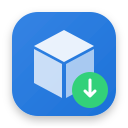

<div align="center">
  
  <h1>InstaLinux</h1>
  <p><strong>Современный графический установщик и менеджер программ для Ubuntu и Debian</strong></p>

  [](LICENSE)
  [](#)
  [](#)
  [](#)
</div>

---

## 📖 О проекте

При переходе с Windows или macOS на Linux многие пользователи сталкиваются с хаосом форматов: одни программы поставляются в виде архивов (`.tar.gz`, `.zip`), другие как независимые `.AppImage`, третьи как пакеты `.deb` или shell-скрипты инсталляции.

**InstaLinux** решает эту проблему раз и навсегда:
1. Вы просто перетаскиваете любой файл (или выбираете его в проводнике).
2. Настраиваете название, иконку и категорию.
3. Программа автоматически распаковывает, настраивает права запуска, создает стандартные FreeDesktop `.desktop`-ярлыки и прописывает бинарники в системные пути.
4. Все программы устанавливаются по **стандартам Linux (FHS / XDG)** и **не зависят от самого InstaLinux**!

---

## ✨ Основные возможности

### 🚀 Универсальная установка
- **Drag & Drop**: прямо из файлового менеджера (Nautilus, Dolphin, Thunar и т.д.).
- **Поддержка форматов**:
  - 📦 **`.deb`** — системные пакеты (автоустановка зависимостей через APT/dpkg).
  - 🚀 **`.AppImage`** — автоматический `chmod +x`, размещение и интеграция в меню.
  - 🗜️ **Архивы** (`.tar.gz`, `.tgz`, `.zip`, `.tar.xz`, `.tar.bz2`) — автораспаковка, автоматический поиск исполняемого бинарника и извлечение иконки.
  - ⚙️ **Скрипты и бинарники** (`.sh`, `.run`, `.bin`) — удобная упаковка в ярлык меню.
- **Стандартное размещение**:
  - *Для текущего пользователя* (`~/.local/opt/` и `~/.local/bin/`) — **не требует root/sudo**!
  - *Для всей системы* (`/opt/` и `/usr/local/bin/`) — с запросом прав суперпользователя.
- **Гибкая кастомизация**: смена названия, подбор/загрузка кастомной иконки (PNG/SVG), выбор категории меню (Офис, Разработка, Игры и т.д.) и опция запуска в терминале.

### 🗂️ Вкладка «Мои установки»
- Полный реестр всех программ, установленных через InstaLinux.
- Кнопка «Открыть папку программы» в файловом менеджере.
- Чистое удаление файлов и ярлыков в один клик.

### 🧹 Вкладка «Все программы ПК» и Поиск дубликатов
- Сканирование всех установленных GUI-приложений в системе:
  - 🔹 **APT / DEB**
  - 🔹 **Snap**
  - 🔹 **Flatpak**
  - 🔹 **Пользовательские ярлыки**
- **Фильтр «Только дубликаты»**: быстро находит дублирующиеся приложения (например, одна версия из Snap, а вторая из DEB).
- **Живой поиск** по названию, команде запуска или типу пакета.
- **Асинхронное удаление**: процесс ввода root-пароля не блокирует интерфейс.

---

## 📥 Быстрая установка

### 1. Клонирование репозитория
```bash
git clone https://github.com/ваш-аккаунт/InstaLinux.git
cd InstaLinux
```

### 2. Запуск скрипта установки
```bash
./install.sh
```

Скрипт автоматически:
- Проверит системные зависимости (`python3-gi`, `gir1.2-gtk-4.0`, `gir1.2-adw-1`, утилиты распаковки архивов).
- Установит исполняемый файл в `~/.local/bin/instalinux`.
- Зарегистрирует иконки высокого разрешения и добавит ярлык в системное меню приложений.

---

## 🖥️ Использование

- **Из системного меню**: найдите **InstaLinux** среди приложений (нажмите `Super` / `Win` и начните вводить имя).
- **Из терминала**:
  ```bash
  instalinux
  ```

---

## 🗑️ Удаление InstaLinux

Если вы захотите удалить сам InstaLinux:
```bash
./uninstall.sh
```
*(Все программы, которые вы установили с его помощью в `~/.local/opt/` или `/opt/`, останутся в системе и продолжат работать в обычном режиме!)*

---

## 🧪 Тестирование

Для запуска набора модульных тестов:
```bash
python3 -m unittest discover tests
```

---

## 📂 Структура проекта

```
InstaLinux/
├── assets/                  # Иконки приложения (SVG и растровые PNG 16-256px)
├── src/
│   ├── app.py               # Графический интерфейс (GTK 4 / Libadwaita)
│   ├── inspector.py         # Детектор форматов и экстрактор метаданных
│   ├── installer.py         # Движок установки и удаления пакетов
│   └── models.py            # Модели данных, системный сканер и стандарты путей
├── tests/
│   └── test_core.py         # Набор модульных тестов
├── install.sh               # Скрипт быстрой установки в систему
├── uninstall.sh             # Скрипт удаления установщика
├── main.py                  # Точка входа в приложение
├── LICENSE                  # Лицензия MIT
└── README.md                # Документация проекта
```

---

## 📄 Лицензия

Проект распространяется под открытой лицензией [MIT](LICENSE).
